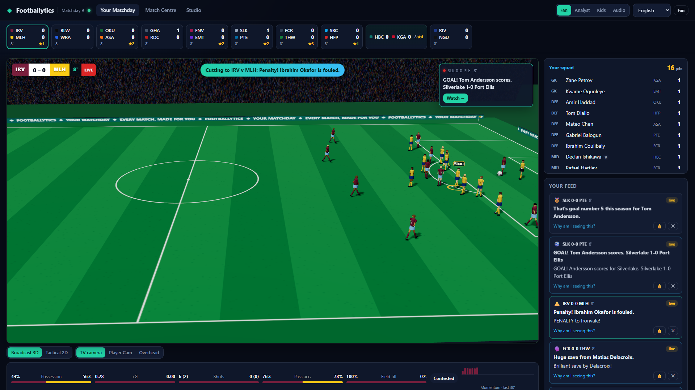
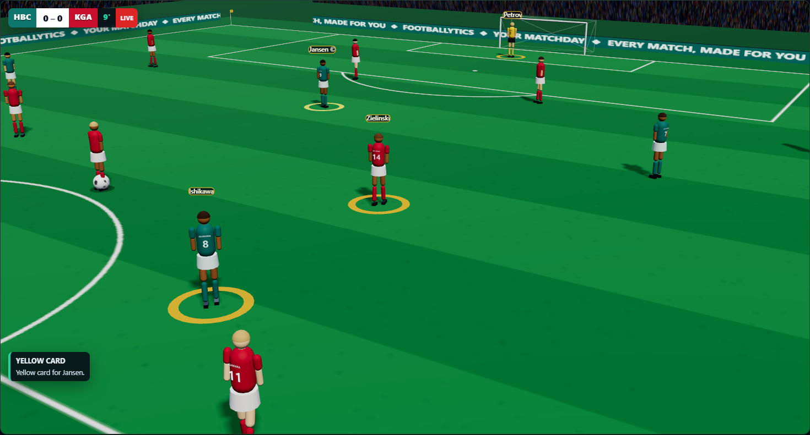
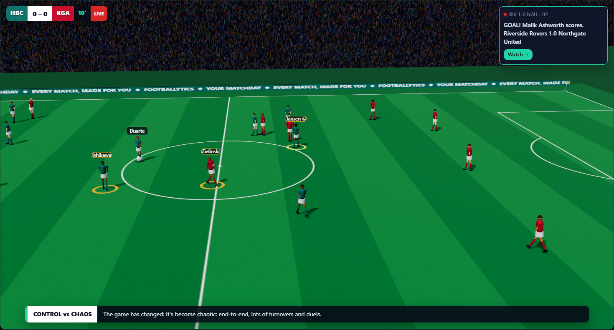
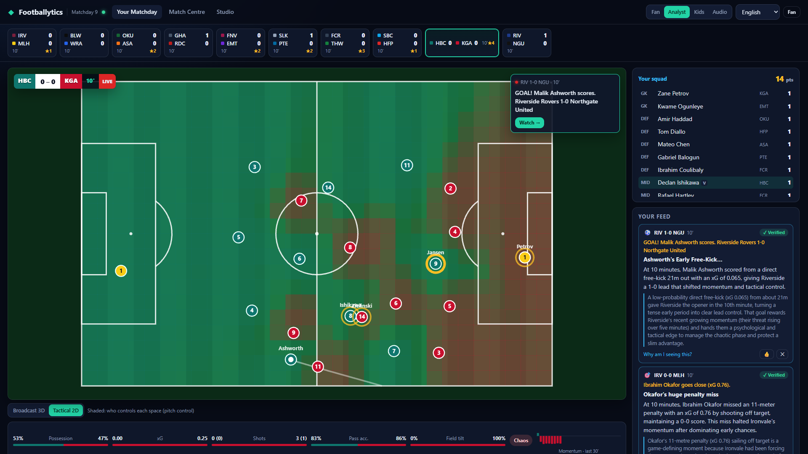
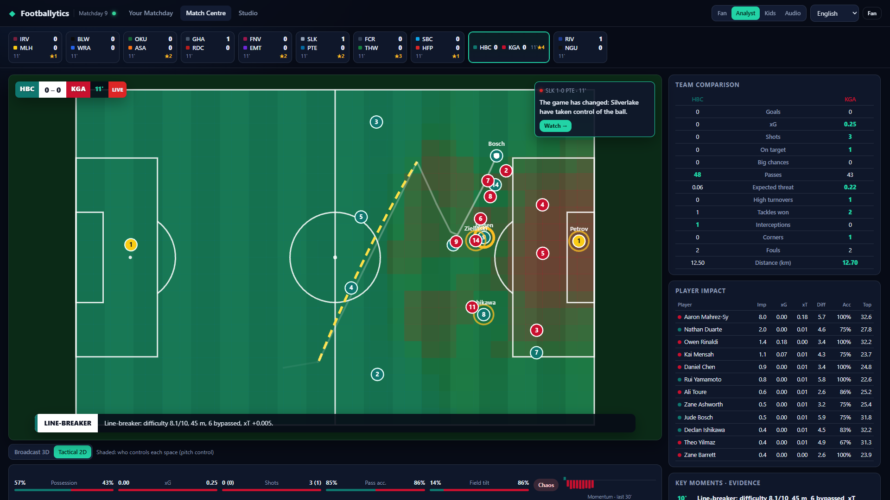
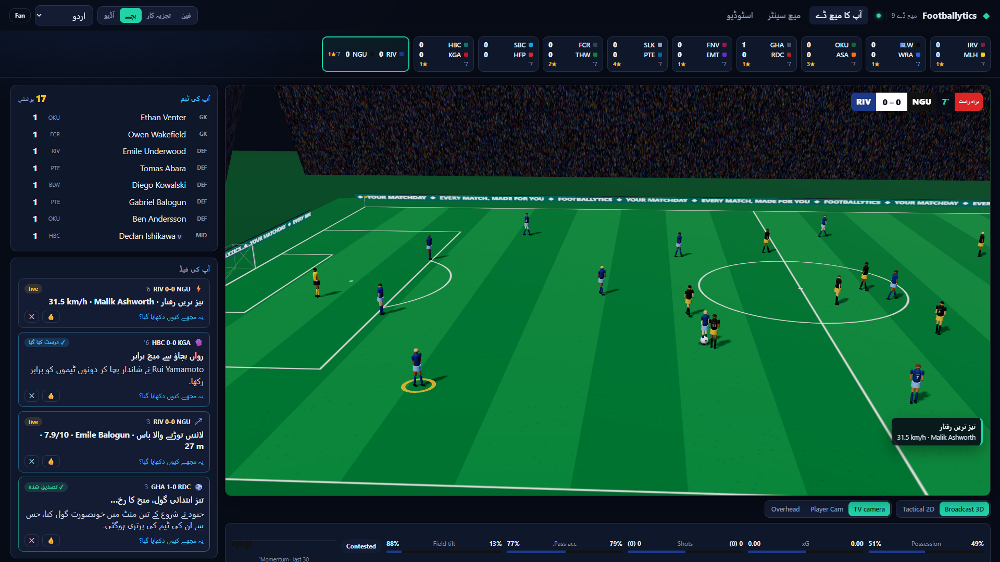
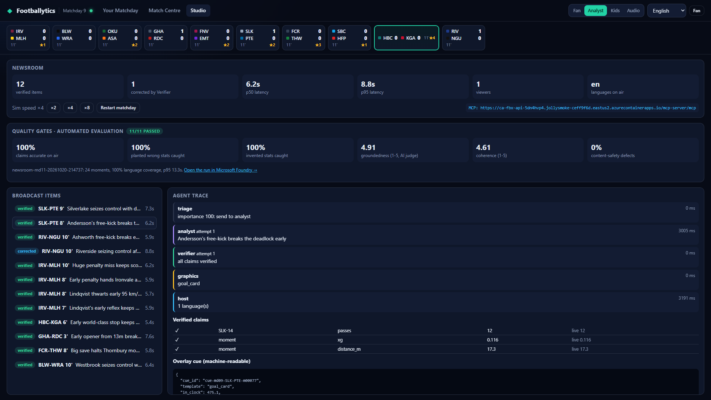
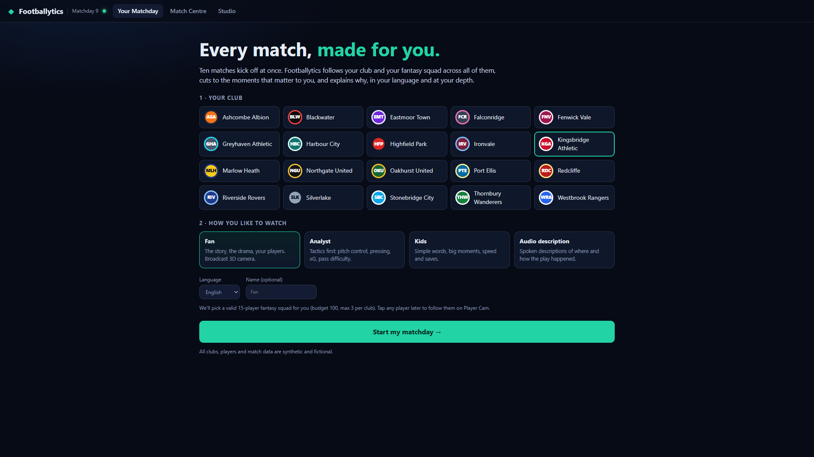

# Footballytics: Your Matchday

**Every match, made for you.** On a matchday, ten matches kick off at once. Footballytics follows *your* club and *your* fantasy squad across all of them. It cuts to the moments that matter to you and explains **why** they matter, in your language and at your depth: fan, analyst, kids or audio description.

Built for the **Microsoft × Premier League "Inside the Game" Developer Hackathon**. All clubs, players and match data are synthetic and fictional.

> **Live demo:** https://ca-fbx-api-5dn4hvp4.jollysmoke-ceff9f6d.eastus2.azurecontainerapps.io · **Demo video:** _link_
> **MCP endpoint:** `https://ca-fbx-api-5dn4hvp4.jollysmoke-ceff9f6d.eastus2.azurecontainerapps.io/mcp-server/mcp`
>
> Matchdays play on a loop at 4× speed, so a match is always live. Pick a club, and the app builds you a fantasy squad and starts your personal broadcast.
>
> **New here?** The [user guide](docs/USER_GUIDE.md) has a 2-minute tour and explains every screen and button.



---

## What it does: one pipeline, five stages

| Stage | Footballytics |
|---|---|
| **Ingest** | **MatchForge**, our agent-based simulator, streams events and 10 Hz tracking for a whole matchday of concurrent matches. It calibrates against 15 real-world benchmarks and **passes 15/15** (see [Realism](#synthetic-data-matchforge)). |
| **Interpret** | A deterministic stats engine (about 0.06 ms per frame) computes: <ul><li>Shots: xG with pressure measured from tracking.</li><li>Passing: xT added, **pass difficulty 1–10**, pass accuracy, line-breaking passes.</li><li>Speed: ball and shot speed, sprint and speed tags.</li><li>Team shape: pitch control, momentum, **control vs chaos**, PPDA pressing shifts, tempo.</li><li>Live **fantasy points**.</li></ul> |
| **Explain** | An **agent newsroom** on Microsoft Agent Framework and Foundry explains *why* moments matter. A **Verifier** checks every number against live data and sends wrong claims back for a rewrite. |
| **Render** | Timed, machine-readable **overlay cues** drive a broadcast graphics layer on a live **3D broadcast camera** or a **2D tactical view**. |
| **Personalize** | A **Personal Director** cuts between matches for each fan. It weighs their fantasy squad (captain counts double), their club, their **learned taste** and the **one stat they follow** (top speed, shot speed, pass difficulty, xG, distance or line-breaking passes, with a live top 5 across every match), and every decision answers "why am I seeing this?". |

## Screenshots

| | |
|---|---|
|  **Player Cam.** Tap a squad player and the camera follows them. |  **Broadcast 3D.** Picture-in-picture when something big happens elsewhere. |
|  **Analyst mode.** Pitch control, xG, and a verified *why it matters*. |  **Match Centre.** Team comparison, player impact and evidence for every moment. |
|  **Kids mode in Urdu (RTL).** Stories written natively in Urdu by the Host agent. |  **Studio.** Quality gates, the agent trace and every verified claim. |



## The agents (Microsoft Agent Framework + Microsoft Foundry)

```
   moment ─► Triage ──► Analyst (gpt-5-mini) ──► Verifier ──(claims ok)──┬─► Host (gpt-4.1-mini) ─┐
   (stats      │              ▲                     │                    └─► Graphics ────────────┴─► Publisher ─► broadcast item
   engine)     │              └──(corrections)──────┘ max 2 rewrites
               └─(low importance)─► instant template caption
```

| Agent | Role |
|---|---|
| **Analyst** | Explains why a moment matters (game state, momentum, control vs chaos, the player's season). Every statistic it uses is returned as a structured claim. |
| **Verifier** | Deterministic. Checks each claim against live data and audits every number in the prose against the evidence. Precise corrections go back to the Analyst. Every number on air is traceable. |
| **Host** | Renders the verified insight for **fan, analyst, kids and audio-description** audiences, natively in each language the audience requested. |
| **Graphics Producer** | Emits the timed overlay cue: template, in/out, priority, anchor and data. |
| **Personal Director** | Per-fan relevance and cut / picture-in-picture / ticker decisions under an interruption budget. |
| **Director planner** | LLM. Writes each fan's "watch next" brief. |
| **Taste Learner** | Adapts what each fan sees from skips, likes and replays, and explains what it learned. |
| **Pundit** | Answers free-form questions by calling the **Football Intelligence tools**. Every tool call is traced in the UI. |
| **Recap Editor** | Writes a verified full-time story for each match. |

Model calls use **keyless Entra ID auth** through a managed identity; local auth is disabled on every Azure service. Template captions appear instantly, and agent-written lines replace them about 10 s later. If the models are unavailable, the broadcast degrades to templates instead of going blank.

## Football Intelligence MCP server

The same 12 tools our agents use are exposed over **MCP (streamable HTTP)** at `/mcp-server/mcp`. Tools include:

- `list_live_matches`, `get_match_state`, `get_moments`
- `explain_moment`, `verify_claims`
- `get_pitch_control`, `fantasy_points`, …

GitHub Copilot agent mode, Claude or a Foundry agent can query the live matchday. `.vscode/mcp.json` is included.

## Architecture (Azure)


- **One image, two Container Apps.**
  - The **api** app runs the web app, REST, WebSocket and MCP, plus the live hub, the newsroom and one Personal Director per viewer.
  - The **archiver** consumes the Event Hubs stream (Blob checkpoints) and writes to **Cosmos DB** (serverless). Match events are stored one document per match-minute, so a match costs about 100 writes rather than one per event.
- **Keyless everywhere.** One user-assigned managed identity holds the Foundry, Event Hubs, Cosmos DB, Storage and ACR roles. Local auth is disabled on every service.
- **Observability.** OpenTelemetry from the app and from Agent Framework flows to **Application Insights**. That resource is connected to the Foundry project, so agent traces also appear under Foundry **Tracing** (see [below](#quality-automated-evaluation-and-foundry-tracing)).
- **Always live:** matchdays loop, so judges always land on football in progress. Results fold into an evolving league table.
- **Cost-aware:**
  - Agents only spend tokens while someone is watching.
  - When nobody has watched or called the API for 3 minutes, the live matchday pauses: no simulation, streaming, archive writes or model calls. The next visitor resumes it straight away.

## Quality: automated evaluation and Foundry tracing

Every number a fan hears has to be true. That claim is **measured on every change**, not assumed.

```bash
cd backend && .venv/Scripts/pip install -e ".[evals]"
.venv/Scripts/python -m footballytics.evals.run --matchdays 11,12,13 --items 72   # exits non-zero if a gate fails
```

The harness plays three matchdays the newsroom has never seen. It sends 72 moments through the real Triage, Analyst, Verifier, Host and Publisher workflow in three languages (en, es, ar), then scores the output three ways:

1. **Deterministic checks.**
   - Every structured claim is re-checked against live data.
   - Every number in every published rendition (fan, analyst, kids, audio, label, each language) must trace to the evidence the Host was given.
   - Language coverage and latency are measured.
2. **Planted-error tests.** Six kinds of error are planted in every published item, at the moment it is produced:
   - a claim inflated by 50%;
   - a claim just outside the Verifier's tolerance;
   - the right number credited to the wrong player or team;
   - a fixed fabricated sentence;
   - a randomly drawn fabricated sentence;
   - a fabricated number inside a translated rendition (in Arabic digits for Arabic).

   Two controls measure false alarms: the untouched item, and a claim moved but kept within tolerance. Every rate comes with its 95% confidence interval.
3. **AI judges via the Azure AI Evaluation SDK.** Groundedness, relevance, coherence and fluency, plus content safety (hate, sexual, violence, self-harm). The run is **logged to the Foundry project**, so it appears under *Evaluations*.

Latest run ([full report](docs/EVALUATION.md), [Foundry run](https://ai.azure.com/resource/build/evaluation/939105f3-ffba-4559-ae90-2a97158baca4?wsid=/subscriptions/991df65a-d37a-4d15-9414-3a448ce23817/resourceGroups/rg-footballytics-dev/providers/Microsoft.CognitiveServices/accounts/fbx-ai-5dn4hvp4nnbzs/projects/footballytics&tid=c46e3e34-90fe-4e13-9135-bdf6c03b41be)): **16/16 gates pass.**

| Measure | Result |
|---|---|
| Published claims that match live data | **216 / 216** (within 5%, or 0.02 for small decimals / 0.5 for counts) |
| Planted errors caught, six kinds | **567 / 574** (95% CI 98–99%) |
| False alarms on correct items | **0 / 144** |
| Fabricated numbers in translations, removed before air | **211 / 216** |
| Groundedness · relevance · coherence (1–5, AI judge) | **4.91 · 5.00 · 4.55** |
| Content-safety defects | **0%** |
| Latency p50 / p95 (Analyst + Verifier + 3-language Host) | **8.1 s / 12.9 s** |

**What the evaluation changed.**
- The first version caught only 67% of fabricated statistics, because the prose audit was too tolerant and coordinates and IDs counted as evidence. The audit is now precision-aware.
- It also showed that the Host's renditions were audited but never blocked. They now get one rewrite, and any sentence that still carries an unverified number is removed before air.
- Checking the Host against the whole match context let a random invented number pass about 6% of the time, by coinciding with some unrelated statistic. The Host is now checked against only what it was given.

**Known blind spots,** reported in the report rather than hidden:
- Whole numbers 0–11 are exempt from the number audit, because prose uses them for counts and ordinals.
- A correct number credited to the wrong player in the prose (as opposed to in a claim) isn't caught.
- Statements without numbers are judged only by the AI judge.

The live **Studio** shows the latest gates (`/api/evals`).

**CI** (`.github/workflows/`):
- `ci.yml` runs the tests, the realism scorecard and the frontend build on every push.
- `evals.yml` runs the evaluation when started by hand, because every run spends Foundry credit on the AI judges. It signs in to Azure through OIDC (no secrets), fails the build if a gate regresses, and uploads the report.

**Tracing.**
- `enable_instrumentation()` turns on Agent Framework's OpenTelemetry spans: `workflow.run`, one `executor.process` per newsroom step, `invoke_agent` and `chat gpt-5-mini`, with token usage.
- The spans go to Application Insights. Bicep connects that resource to the Foundry project (`connections/appinsights`), so every agent run is in **Foundry → Tracing**.
- Pundit tool calls are traced by Agent Framework function middleware and shown in the UI.

## Auto-eventing: broadcast video → events

The challenge suggests auto-eventing: running a model over a video feed to produce the pass and speed metrics
automatically. Ours runs against an answer key, because the video is synthetic too.

1. **Video.** A window of a simulated match is rendered as broadcast video by the app's own 3D renderer
   (`frontend/render.html`, driven headless by Playwright), with the same TV camera fans watch.
2. **Detection.** A COCO-pretrained Faster R-CNN (torchvision, not fine-tuned) finds the players. It runs a second
   time on a 2× zoomed window around the ball, because that's where duels merge two players into one box.
   Near-ball recall rose from 54% to 93% with the zoom.
3. **Ball.** A classical detector finds the ball, which is only about 10 px on screen. A dynamic-programming search
   then picks the most plausible path through every frame's candidates.
4. **Tracking.** Foot points go through the camera's ground-plane homography to pitch coordinates. Teams come from
   k-means on shirt colour, and Hungarian tracking links the detections.
5. **Events.** A *flight* is the ball moving faster than a dribble. A flight to a team-mate is a pass and a flight to
   an opponent is an interception. Speeds come from the smoothed tracks.


Scored against the simulator's own events and tracking, 45 s of Harbour City v Kingsbridge
([full report](docs/AUTO_EVENTING.md)):

| | Result |
|---|---|
| Players found / position error | 85% recall at 92% precision / 0.37 m on the pitch |
| Pass attempts found | 9 of 13; completed vs intercepted right in 78% of those, passing team in 89% |
| Pass speed | within 1.4 km/h of the truth on average |
| Player top speed | within 2.6 km/h, over 22 players |
| Ball | tracked in 99% of frames where it is on screen and on the ground (median error 0.76 m) |

These are honest numbers, and the report lists the limits:
- Lofted balls have no ground position.
- A marker standing in front of the passer hides them from a single camera.
- The renders are cleaner than real footage.

The Studio shows the latest run (`/api/autoevent`).

```bash
cd backend && .venv/Scripts/pip install -e ".[vision]" --extra-index-url https://download.pytorch.org/whl/cpu
.venv/Scripts/python -m footballytics.vision.autoevent --matchday 9 --match HBC-KGA --seconds 45
```

## Synthetic data: MatchForge

- **The world:** a fictional 20-club league with 440 players. Attributes, tactical styles and formations shape play; styles include possession, high press, low block and direct.
- **How players act:** each player chooses actions by expected value, using the same transparent xG and xT models.
- **Tracking:** off-ball movement follows formation, pressing, marking and attacking runs. Movement is acceleration-limited, so the 10 Hz tracking is physically plausible.
- **Event feed:** outcomes are resolved at release and *choreographed*, so events and tracking agree. Events are published when their outcome is known, like real feeds.
- **Ground truth:** shots carry the simulator's true goal probability, so analytics can be evaluated against an answer key.

```
python -m footballytics.cli realism --matches 24     # 15/15 real-world benchmarks
```

| Metric (per match) | MatchForge | Real-world range |
|---|---|---|
| Goals / xG | 2.58 / 2.60 | 2.3–3.3 |
| Shots / on target | 23.9 / 7.6 | 21–29 / 7–10.5 |
| xG per shot | 0.108 | 0.085–0.13 |
| Passes / completion | 1,019 / 78% | 780–1,050 / 77–87% |
| Corners, fouls, yellows, offsides | 10.7, 20.1, 3.8, 3.1 | in range |
| Distance per outfielder / top speed | 9.8 km / 32.4 km/h | 9.4–11.8 km / 31–37 |
| Ball in play | 61% | 52–64% |

## Run it locally

Requirements: Python 3.11+, Node 20+. For agents: an Azure subscription with a Foundry project and `az login`.

```bash
cd backend && python -m venv .venv && .venv/Scripts/pip install -e ".[cloud,dev]"   # (bin/ on macOS/Linux)
cp .env.example .env            # Foundry endpoint + model names (no keys)
cd ../frontend && npm ci && npm run build
cd ../backend && .venv/Scripts/python -m uvicorn footballytics.api.app:app --port 8000
# open http://localhost:8000
```

Without Foundry settings, everything except the LLM agents still runs: simulation, stats, moments, Director, overlays and template captions.

**Tests:** `cd backend && .venv/Scripts/python -m pytest -q` runs 50 tests covering the simulator, engine, tools, agent guard rails and trust guarantees, personalisation, cloud routing, the Studio lock and the auto-eventing logic.

**Screenshots:** `python tools/screenshots.py --url http://localhost:8000/` drives the real UI with Playwright and Edge, and regenerates `docs/images/`.

## Deploy to Azure

```bash
azd up        # provisions infra/main.bicep, builds the image with local Docker, deploys api + archiver
```

Trial subscriptions cannot use ACR Tasks, so `azure.yaml` builds with local Docker.

## Repository layout

```
backend/footballytics/
  sim/        MatchForge simulator, matchday runner, realism scorecard
  engine/     stats engine: metrics, moments, fantasy ledger, live processor
  agents/     newsroom workflow, prompts, verifier audit, recap, pundit, Foundry clients
  evals/      evaluation harness: planted errors, Azure AI Evaluation judges, quality gates
  vision/     auto-eventing: clip, render, detect, track, events, evaluate (python -m footballytics.vision.autoevent)
  personal/   fan profiles, Personal Director, Taste Learner, rundown agent, viewer sessions
  intel/      Football Intelligence tools + MCP server
  api/        FastAPI app (REST, WebSocket, MCP, static web app)
  hub.py      live matchday hub;  cloud.py  Event Hubs / Cosmos / telemetry;  archiver.py  worker
frontend/src/ React + three.js web app (Your Matchday, Match Centre, Studio); pitch/figures.ts = 3D player rigs,
              pitch/stadium.ts = the shared broadcast scene, render/ + render.html = the offline video renderer
infra/        Bicep: Foundry (+ App Insights connection), Container Apps, Event Hubs, Cosmos DB, Storage, ACR, monitoring
tools/        screenshot capture;  .github/workflows/  CI + agent evaluation gates
docs/         EVALUATION.md (latest run), CONCEPT.md, images/
```

## Responsible AI

- **Synthetic data only;** every club and player is fictional.
- **Numbers are verified:** each claim is checked against data, and numbers that can't be traced are rejected or replaced by deterministic text.
- **Continuously evaluated:** planted-error tests, AI judges and content-safety evaluators gate every change to the agents ([report](docs/EVALUATION.md)).
- **Your language from the first second:** before the agents' text arrives, instant graphics show translated labels with names and numbers, never English filler.
- **Explained personalization:** every cut and card carries its reasons, and the Taste Learner says what it learned.
- **Accessibility:** audio-description mode, right-to-left layouts for Arabic and Urdu, kids mode, and reduced-motion support.

## License

MIT
