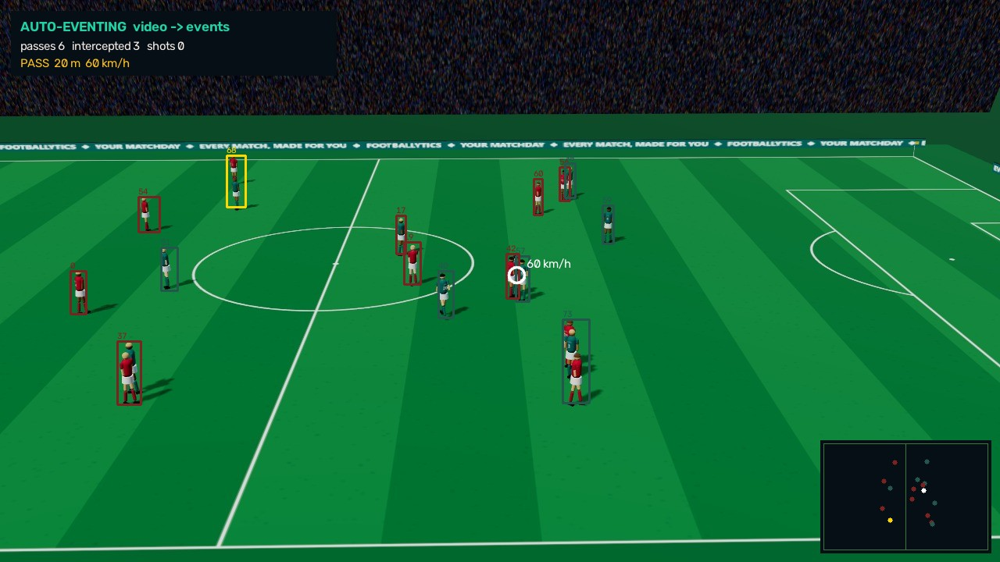

# Auto-eventing: broadcast video → events

Run `autoevent-md09-HBC-KGA-20261021-170258`: 45 s of Harbour City v Kingsbridge Athletic (`md09-HBC-KGA`, from 95.1 min of play), 1131 frames at 25 fps, 1280x720.

The video is rendered by the app's own 3D broadcast renderer from simulator tracking. The pipeline sees only the pixels and the camera calibration. The simulator's events and tracking are the answer key it is scored against.



## Pipeline

| Stage | Method |
|---|---|
| Players | Faster R-CNN MobileNetV3-Large FPN (torchvision, COCO weights, no fine-tuning), person class, every 2 frames (12.5 Hz), then again on a 2x zoomed window around the ball, where duels merge players (1.74 s per frame on CPU for both) |
| Ball | Classical detector (bright, round, compact blobs; shorts and pitch spots rejected), then the most plausible path through all frames' candidates (dynamic programming, bridges occlusions) |
| Pitch coordinates | Foot point through the broadcast camera's ground-plane homography (calibration) |
| Teams | k-means on shirt colour (two teams + keepers), no kit colours given |
| Tracking | Hungarian assignment with constant-velocity prediction; shirt colour as a soft cost |
| Events | A flight = the ball moving faster than a dribble; from a player to a team-mate (median speed above 32 km/h) is a pass, to an opponent an interception; passer = who received the last ball (possession continuity); shot = struck above 50 km/h within 30 m, heading for the goal mouth |
| Speeds | Smoothed track and ball positions → player top speed, sprints (≥ 25.2 km/h), ball and shot speed |

## Results against the answer key

| Metric | Result |
|---|---|
| Player detection (IoU ≥ 0.5) | precision 92%, recall 85% |
| Position on the pitch | mean error 0.37 m, 90th percentile 0.72 m |
| Team assignment | 95% correct |
| Identity (track → player) | 83% of detections on the right track; 75 tracks for 22 players seen |
| Ball | tracked in 99% of frames where it is on screen; 75% of those within 2 m (median error 0.76 m) |
| Pass attempts found (±1 s) | 9 of 13 (recall 69%, precision 69%); passes along the ground 9 of 12 |
| Outcome (completed vs intercepted) / passing team | 78% / 89% correct for the attempts found |
| Completed passes | precision 56%, recall 50%; passer and receiver both identified in 60% |
| Pass speed / length | mean error 1.4 km/h / 0.8 m |
| Shots | 0 of 1 found, 0 predicted; speed error – |
| Player top speed | mean error 2.6 km/h over 22 players |

## Limits

- The renders are stylised: no motion blur, crowd noise or broadcast graphics. Real footage would need fine-tuned detectors.
- The camera calibration comes from the renderer. A real system would estimate it from the pitch lines.
- The ball's position comes from the ground plane, so lofted balls are placed where their shadow would be. That error shows up in the ball and pass-length numbers.
- A pass or shot off camera cannot be seen, which is why on-camera recall is reported separately.
- A blocked shot travels a few metres and looks like any other short kick. When a marker stands between the camera and the passer, possession continuity, not the pixels, names the passing team.
- Identity is kept by tracking alone. Shirt numbers are too small to read at broadcast distance.

## Run it

```bash
cd frontend && npm run build          # the offline renderer is frontend/render.html
cd ../backend && .venv/Scripts/pip install -e ".[vision,evals]"
.venv/Scripts/python -m footballytics.vision.autoevent --matchday 9 --match HBC-KGA --seconds 45
```

A full run takes about 24 min on a laptop CPU (rendering 0.43 s per frame, detection 1.74 s per detector frame; tracking and scoring take seconds). Outputs go to `backend/data/generated/autoevent/` (broadcast.mp4, annotated.mp4, results.json).
